# Bill of Materials
All parts can be found on Amazon, AliExpress, Ebay etc. 

| Part | Reference Photo | Qty | Notes |
|---|---|---|---|
| TMC2209 Pen/Laser FluidNC CNC Controller | 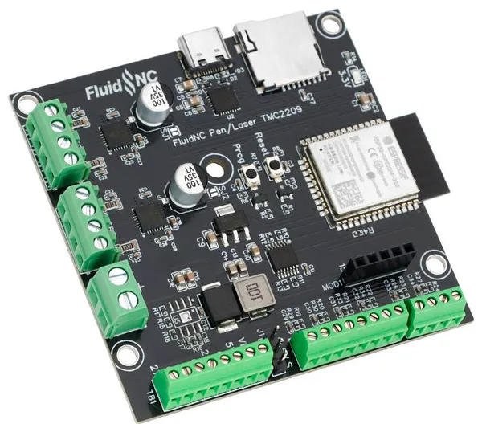 | 1 | |
| Micro SD Card 32GB | 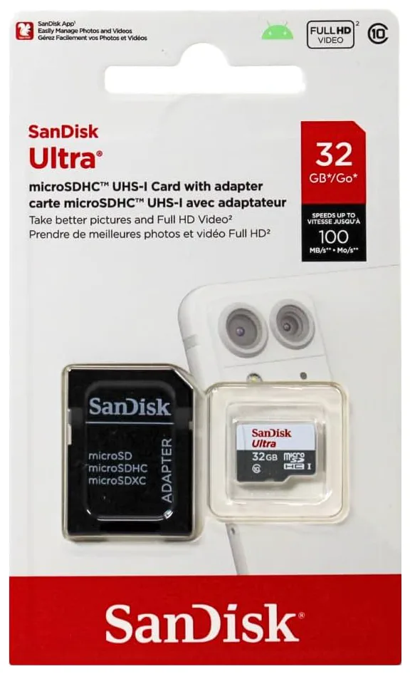 | 1 | |
| STEPPERONLINE Nema 17 Pancake Stepper Motor 1A 17Ncm | 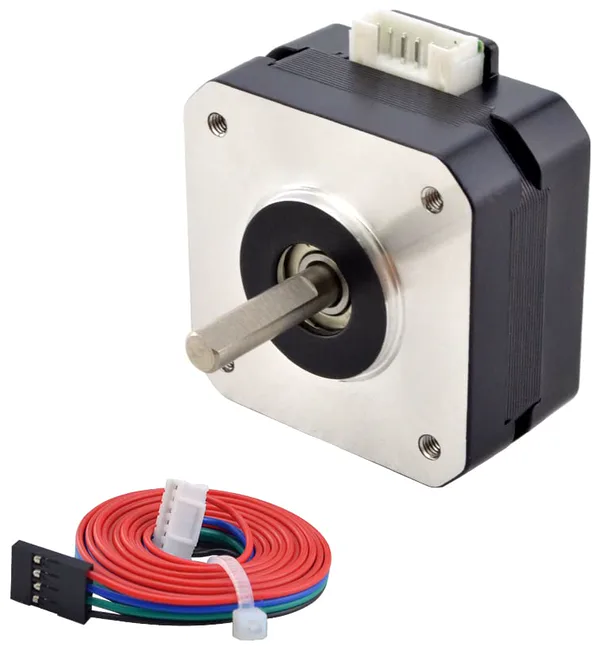 | 2 | |
| GT2 Timing Belt Pulley 16 Teeth, 5mm Bore, for 6mm Width Belt | 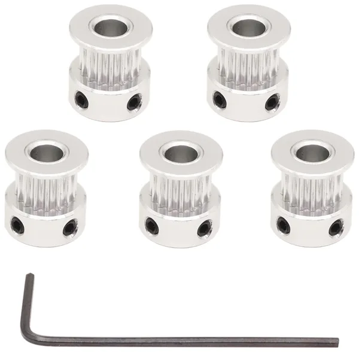 | 2 | Make sure you don't use the 20 teeth version from Mural v1 |
| 623ZZ ball bearings | 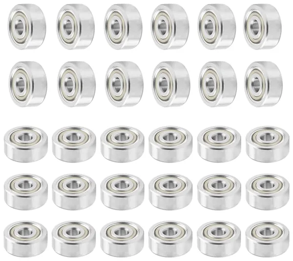 | 2 | |
| 3D Printing GT2 Timing Belt, 10m length, 2mm pitch, 6mm width | 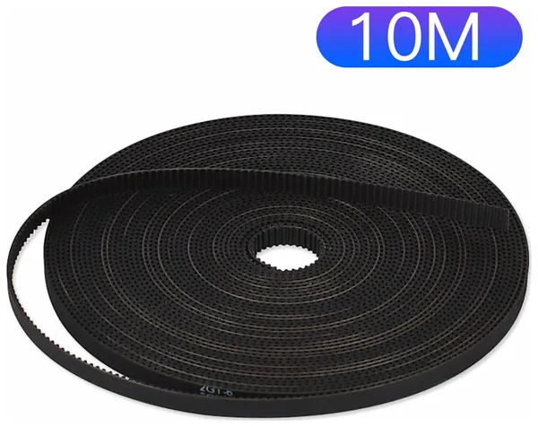 | 1 roll | |
| MG90S 9g Metal Gear Micro Servo | 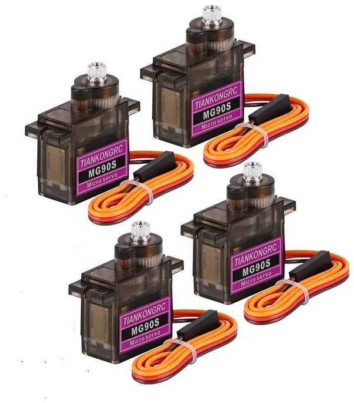 | 1 | |
| USB-C Power Delivery trigger module | 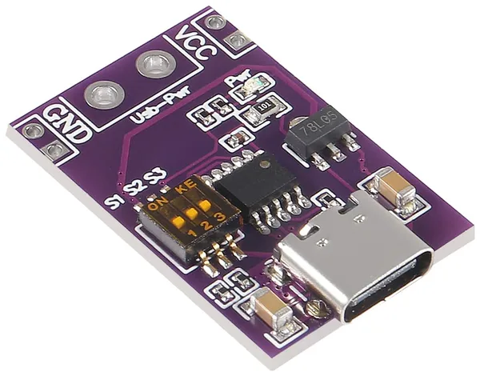 | 1 | |
| M3 bolt kit | 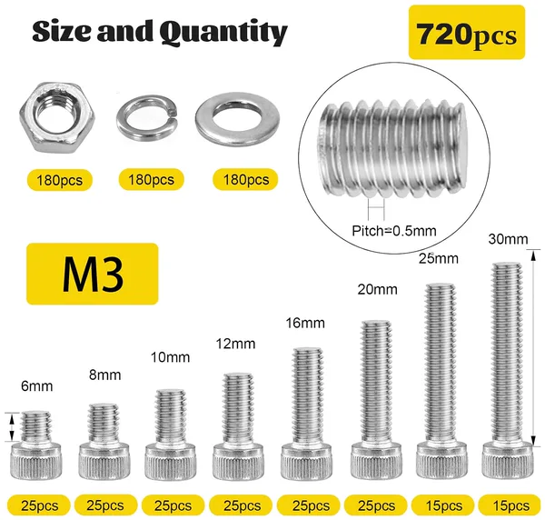 | | You'll need 6/8/10/12/25 mm bolt lengths |
| Threaded Heat Set Inserts Kit M3x4x5 | 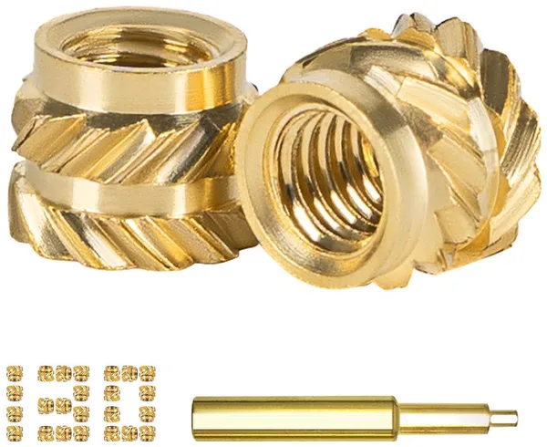 | | |
| M3 thumb screw | 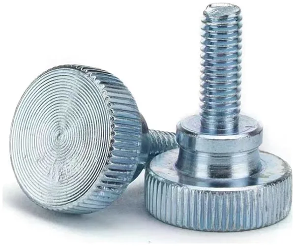 | 1 | |
| 100W USB-C power supply | 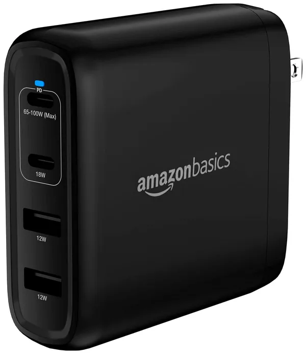 | 1 | 60W should be OK as well |
| 10FT USB-C cable | 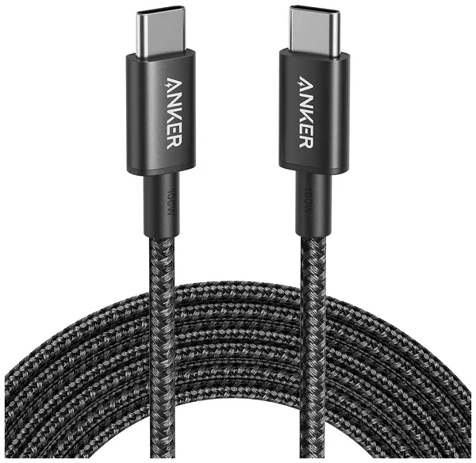 | 1 | |
| 0.91 Inch I2C OLED Display Module | 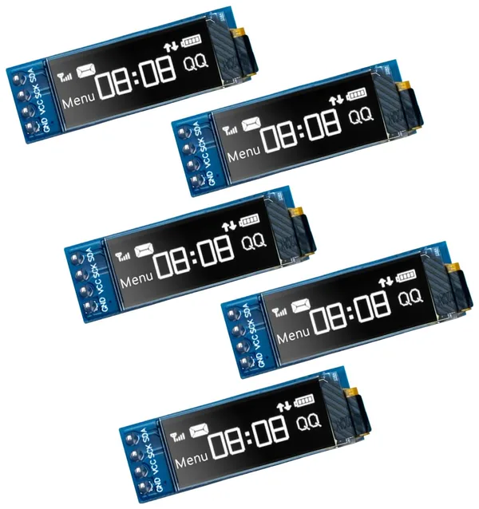 | 1 | |
| 20CM M-F Dupont Wire | 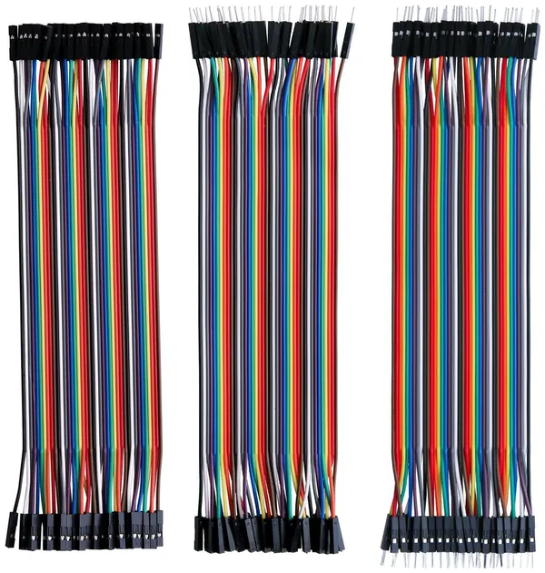 | 4 | |
| 18AWG wire | 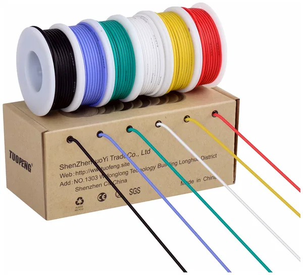 | | |
| Thumbtacks | 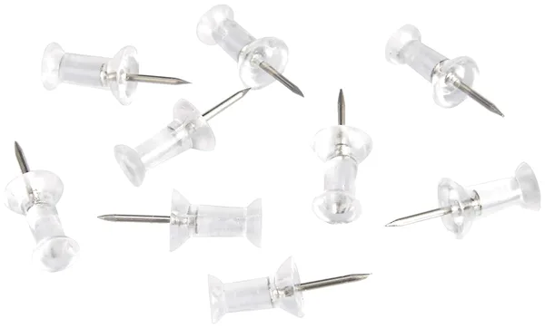 | | |
| Crayola Ultra Washable Markers, Black | 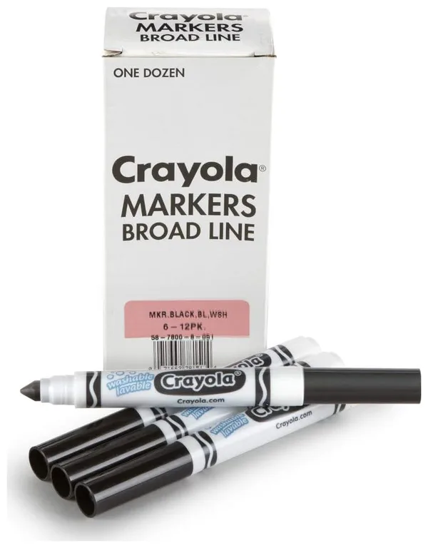 | 1 pack | |
| Crayola Ultra Washable Markers, Multicolor |  | 1 pack | For the upcoming multi-color update |
